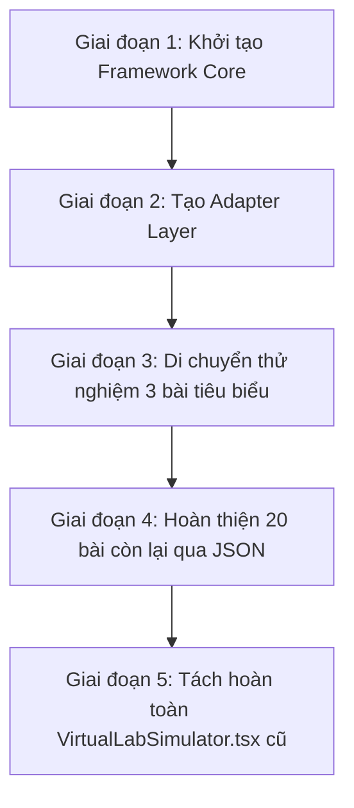

# KIẾN TRÚC DYNAMIC SIMULATION FRAMEWORK (KẾT NỐI TRI THỨC K-9)
> **Tài liệu đặc tả kiến trúc kỹ thuật & Lộ trình Refactor không gián đoạn (Zero-Downtime Migration)**

---

## I. TỔNG QUAN VÀ CHIẾN LƯỢC TƯƠNG THÍCH HOÀN TOÀN

### 1. Vấn đề của Codebase hiện tại
- File `VirtualLabSimulator.tsx` có hơn **9.178 dòng code**.
- Chứa **94 điểm rẽ nhánh cứng** `selectedExpId === "..."`.
- Hơn **75 state riêng lẻ** (`useState`) cho 23 bài thí nghiệm.
- Mỗi khi bổ sung 1 bài thí nghiệm mới, lập trình viên phải:
  1. Thêm `id` vào danh sách `KNTT_EXPERIMENTS`.
  2. Thêm 3-5 `useState` mới vào đầu component.
  3. Thêm các hàm `useMemo` tính toán công thức.
  4. Thêm khối `else if (selectedExpId === "...")` trong `handleLogData`.
  5. Thêm khối JSX render đồ họa (hơn 100-200 dòng SVG/Canvas).
  6. Thêm khối JSX render bảng điều khiển controls (hơn 50-80 dòng).
  7. Thêm khối cột trong bảng số liệu.

### 2. Mục tiêu kiến trúc mới
- **Config-Driven**: 100% bài thí nghiệm được mô tả bằng JSON lưu trữ trong Database (MongoDB / PostgreSQL).
- **Tương thích ngược 100%**: Không xóa hay làm gián đoạn file `VirtualLabSimulator.tsx` cũ; hệ thống hỗ trợ cơ chế chạy song song (Hybrid Runtime):
  - Bài nào đã có JSON $\rightarrow$ nạp qua `SimulationPlatform`.
  - Bài nào chưa migrate $\rightarrow$ chạy qua `VirtualLabSimulator` cũ bình thường.
- **Mở rộng hàng trăm bài học**: Giáo viên hoặc Admin chỉ cần nhập JSON từ Studio mà không cần can thiệp vào mã nguồn Frontend.

---

## II. CẤU TRÚC THƯ MỤC CHUẨN (FOLDER STRUCTURE)

```text
d:\DATN_NTB\Smart_Explorer\frontend\
├── lib\
│   └── simulation-framework\
│       ├── types.ts                   # Định nghĩa toàn bộ TypeScript Interfaces & Schemas
│       ├── store.ts                   # Zustand State Store điều phối state, controls, outputs
│       ├── formula-engine.ts          # Bộ phân tích biểu thức toán học, lượng giác, vật lý
│       ├── rule-engine.ts             # Bộ xử lý điều kiện, animation triggers & timer loops
│       ├── registry.ts                # EngineRegistry nạp lười (Lazy Load) 16 domain engines
│       ├── adapter.ts                 # Adapter chuyển đổi dữ liệu từ KNTT_EXPERIMENTS cũ sang JSON
│       └── sample-configs\            # Cấu hình JSON mẫu của 23 bài thí nghiệm KNTT
│           ├── ohm-circuit.json
│           ├── archimedes.json
│           ├── lever-balance.json
│           └── ...
└── components\
    └── simulation-framework\
        ├── SimulationPlatform.tsx     # Master Container hiển thị giao diện phòng lab
        ├── DynamicControls.tsx        # Render 6 loại điều khiển (slider, switch, select,...)
        ├── DynamicOutputs.tsx         # Render các thẻ đại lượng đo & telemetry
        ├── UniversalSceneRenderer.tsx # Render đồ họa động React-Konva Canvas
        └── engines\                   # 16 Engines chuyên biệt cho từng miền kiến thức
            ├── ObservationEngine.tsx  # Soi kính lúp, kính hiển vi, zoom/pan
            ├── LabelingEngine.tsx     # Gắn nhãn, chú thích sơ đồ giải phẫu
            ├── QuizEngine.tsx         # Câu hỏi trắc nghiệm thực nghiệm
            ├── MechanicsEngine.tsx    # Cơ học: Đòn bẩy, ròng rọc, ma sát, lò xo
            ├── CircuitEngine.tsx      # Điện học: Mạch điện, định luật Ôm, ampe kế
            ├── ThermalEngine.tsx      # Nhiệt học: Sự nở vì nhiệt, nhiệt kế, sự sôi
            ├── FluidEngine.tsx        # Thủy tĩnh: Áp suất chất lỏng, Ác-si-mét
            ├── ChemistryEngine.tsx    # Hóa đại cương: pH, dung dịch, đổi màu chỉ thị
            ├── ElectrolysisEngine.tsx # Điện phân: Điện cực than chì, mạ kim loại
            ├── ReactionEngine.tsx     # Động học hóa học: Tốc độ phản ứng, xúc tác
            ├── CellEngine.tsx         # Sinh học tế bào: Không bào, màng, lục lạp
            ├── HumanBodyEngine.tsx    # Cơ thể người: Nhịp tim, hô hấp, tuần hoàn
            ├── EcosystemEngine.tsx    # Hệ sinh thái: Chuỗi thức ăn, tháp sinh thái
            ├── SolarSystemEngine.tsx  # Thiên văn: Quỹ đạo hành tinh, nhật thực
            ├── EarthEngine.tsx        # Địa lý: Hiện tượng ngày/đêm, trục nghiêng
            └── WeatherEngine.tsx      # Khí tượng: Tuần hoàn nước, khí áp, gió
```

---

## III. TYPE DEFINITIONS & SCHEMA CHUẨN

### 1. Cấu trúc JSON của một Thí nghiệm (`ExperimentSchema`)
```typescript
export type GradeLevel = 1 | 2 | 3 | 4 | 5 | 6 | 7 | 8 | 9;
export type SubjectDomain = "physics" | "chemistry" | "biology" | "science" | "earth_astronomy";

export type EngineType =
  | "observation" | "labeling" | "quiz"
  | "mechanics" | "circuit" | "thermal" | "fluid"
  | "chemistry" | "electrolysis" | "reaction"
  | "cell" | "human_body" | "ecosystem"
  | "solar_system" | "earth" | "weather";

export interface ExperimentSchema {
  id: string;                     // Trùng với exp.id cũ (vd: "ohm_circuit", "lever_balance")
  code: string;                   // Mã bài giảng GDPT (vd: "KHTN-G8-B16")
  title: string;                  // Tên bài thí nghiệm
  grade: GradeLevel;              // Khối lớp (1-9)
  subject: SubjectDomain;         // Môn học
  engine: EngineType;             // Loại engine xử lý render
  controls: ControlConfig[];      // Danh sách điều khiển
  outputs: OutputConfig[];        // Danh sách đại lượng đầu ra
  formulas: FormulaConfig[];      // Công thức tính toán
  scene: SceneConfig;             // Cấu hình các đối tượng đồ họa trên Canvas
  rules: RuleConfig[];            // Quy tắc tương tác, hoạt ảnh và trigger
}
```

### 2. Định nghĩa Control (`ControlConfig`)
Hỗ trợ đầy đủ 6 loại điều khiển hiện có trong `VirtualLabSimulator`:
```typescript
export type ControlInputType = "slider" | "switch" | "select" | "button" | "radio" | "number";

export interface ControlConfig {
  id: string;                    // Tên biến (vd: "voltage", "resistance", "fluidDepth")
  label: string;                 // Nhãn hiển thị tiếng Việt
  type: ControlInputType;        // Loại UI control
  defaultValue: any;             // Giá trị khởi tạo
  min?: number;                  // Cho slider / number
  max?: number;
  step?: number;
  unit?: string;                 // Đơn vị đo (V, A, N, cm, °C)
  options?: Array<{ label: string; value: any }>; // Cho select / radio
  disabled?: boolean;
}
```

### 3. Định nghĩa Công thức & Đầu ra (`FormulaConfig` & `OutputConfig`)
```typescript
export interface FormulaConfig {
  id: string;                    // Mã công thức (vd: "currentAmp", "buoyantForceN")
  expression: string;            // Biểu thức (vd: "isSwitchClosed ? (voltage / resistance) : 0")
  targetOutputId?: string;       // Gán giá trị tính được vào Output nào
  precision?: number;            // Số chữ số phần thập phân làm tròn
}

export interface OutputConfig {
  id: string;                    // Mã đầu ra (vd: "out_current", "out_power")
  label: string;                 // Tên đại lượng (vd: "Cường độ dòng điện I")
  unit?: string;                 // Đơn vị (vd: "A", "W", "Pa")
  precision?: number;            // Làm tròn
  formulaId?: string;            // Liên kết công thức nguồn
}
```

### 4. Định nghĩa Đồ họa Scene (`SceneConfig` & `SceneElement`)
```typescript
export interface SceneElement {
  id: string;
  type: "rect" | "circle" | "line" | "arrow" | "text" | "group" | "image" | "custom";
  x: number | string;
  y: number | string;
  width?: number | string;
  height?: number | string;
  radius?: number | string;
  fill?: string;
  stroke?: string;
  strokeWidth?: number;
  rotation?: number | string;
  opacity?: number | string;
  visible?: boolean | string;
  points?: number[];
  text?: string;
  fontSize?: number;
  draggable?: boolean;
  bindings?: Record<string, string>; // Liên kết hai chiều với state (vd: { rotation: "leverAngle" })
  children?: SceneElement[];
}

export interface SceneConfig {
  width: number;
  height: number;
  backgroundColor?: string;
  grid?: boolean;
  elements: SceneElement[];
  customProps?: Record<string, any>;
}
```

---

## IV. CÁCH MAPPING TỪNG PHẦN VỚI CODEBASE HIỆN TẠI

### 1. Mapping Engine Registry với 23 bài thí nghiệm hiện có

| Bài thí nghiệm cũ (`selectedExpId`) | Engine Type tương ứng | Nhiệm vụ của Engine |
| :--- | :--- | :--- |
| `ohm_circuit` | `circuit` | Vẽ mạch điện, dây dẫn, cực pin, công tắc, bóng đèn sợi đốt phát sáng |
| `electromagnet_field` | `circuit` / `mechanics` | Mô phỏng từ trường ống dây, hút đinh sắt |
| `electromagnetic_induction` | `circuit` | Nam châm chuyển động, góc lệch kim điện kế Galvanometer |
| `electrolysis_copper_chloride` | `electrolysis` | Bình điện phân, cực than chì, ion Cu2+ bám màu đỏ, khí Cl2 |
| `archimedes_buoyancy` | `fluid` | Lực kế lò xo, bình chia độ, vật chìm, lực đẩy Fa |
| `fluid_pressure_vessels` | `fluid` | Áp kế chữ U, màng cao su, độ sâu h, bình thông nhau |
| `lever_balance` | `mechanics` | Điểm tựa O, thanh đòn bẩy nghiêng theo mô-men lực F1·d1 vs F2·d2 |
| `friction_force` | `mechanics` | Kéo khối gỗ trượt trên kính, gỗ, giấy nhám có lực kế |
| `spring_hooke_elasticity` | `mechanics` | Giá treo, lò xo dãn Δl tỉ lệ thuận với trọng lượng quả nặng P |
| `thermal_expansion_solids` | `thermal` | Quả cầu kim loại 's Gravesande hơ lửa đèn cồn nở ra kẹt lại |
| `sound_reflection_echo` | `physics` | Sóng âm lan truyền gặp vách đá dội lại đo tiếng vang |
| `sound_oscilloscope_frequency` | `physics` | Đồ họa sóng sin dao động ký, tần số Hz, độ to dB |
| `optics_refraction` | `observation` | Tia laser khúc xạ qua khối bán nguyệt thủy tinh, định luật Snell |
| `optics_convex_lens` | `observation` | Trục chính, 3 tia sáng đặc biệt, sự tạo ảnh thật/ảnh ảo |
| `optics_plane_mirror` | `observation` | Tia tới, góc phản xạ i' = i, ảnh ảo đối xứng qua gương |
| `chemical_mass_conservation` | `chemistry` | Cân điện tử, cốc BaCl2 + Na2SO4 kết tủa trắng không đổi khối lượng |
| `reaction_rate_factors` | `reaction` | Sủi bọt khí H2, pít-tông thu khí di chuyển theo thời gian |
| `acid_base_ph_indicator` | `chemistry` | Đổi màu quỳ tím, phenolphthalein và thang đo pH vạn năng |
| `exothermic_endothermic_reaction`| `thermal` / `chemistry` | Bình phản ứng cách nhiệt, nhiệt kế tăng (tỏa) hoặc đóng băng (thu) |
| `photosynthesis_starch` | `observation` | Bịt giấy đen, đun cồn cách thủy, nhỏ iot thử tinh bột |
| `mixture_separation` | `chemistry` | Phễu lọc cát và đun cô cạn tinh thể muối NaCl |
| `osmosis_cell_turgor` | `cell` | Tế bào hành tía, không bào co nguyên sinh trong môi trường ưu trương |
| `plant_phototropism` | `cell` / `observation` | Ngọn cây đậu uốn cong về phía nguồn sáng do hormone Auxin |

### 2. Mapping State Store (Zustand) với `useState` hiện có

Trong code cũ (`VirtualLabSimulator.tsx` dòng 1456 - 1582):
```typescript
// CŨ (Phải khai báo hơn 70 useState rải rác)
const [voltage, setVoltage] = useState(12);
const [resistance, setResistance] = useState(10);
const [isSwitchClosed, setIsSwitchClosed] = useState(true);
const [buoyancyMaterial, setBuoyancyMaterial] = useState("aluminum");
const [fluidDepth, setFluidDepth] = useState(25);
```

**MAPPING SANG STORE MỚI**:
Tất cả các biến này được lưu trữ tự động trong `useSimulationStore`:
- `controls["voltage"] = 12`
- `controls["resistance"] = 10`
- `controls["isSwitchClosed"] = true`
- `controls["buoyancyMaterial"] = "aluminum"`
- `controls["fluidDepth"] = 25`

Khi người dùng thao tác trên giao diện, chỉ cần gọi một hàm duy nhất:
```typescript
setControlValue("voltage", 18);
```
Ngay lập tức:
1. Store cập nhật giá trị `controls["voltage"] = 18`.
2. Store tự động gọi `FormulaEngine` để tính lại dòng điện `currentAmp` và công suất `powerWatt`.
3. Store tự động kích hoạt `RuleEngine` để điều chỉnh độ sáng bóng đèn trên Canvas Scene.
4. Toàn bộ quá trình diễn ra phản ứng tức thì (reactive) mà không cần code thêm bất kỳ hook nào.

### 3. Mapping Formula Engine với các hàm `useMemo` hiện có

Trong code cũ (`VirtualLabSimulator.tsx` dòng 1708 - 2315), hàng loạt hàm `useMemo` tính toán logic được viết cứng:

#### Ví dụ 1: Định luật Ôm
- **Code cũ**:
  ```typescript
  const currentAmp = useMemo(() => {
    if (!isSwitchClosed) return 0;
    return parseFloat((voltage / resistance).toFixed(2));
  }, [isSwitchClosed, voltage, resistance]);
  ```
- **Mapping sang Formula JSON**:
  ```json
  {
    "id": "currentAmp",
    "expression": "isSwitchClosed ? (voltage / resistance) : 0",
    "targetOutputId": "out_current",
    "precision": 2
  }
  ```

#### Ví dụ 2: Lực đẩy Ác-si-mét
- **Code cũ**:
  ```typescript
  const inAirWeightN = parseFloat((objMassKg * 9.8).toFixed(2));
  const buoyantForceN = parseFloat((liquidDensities[liquidType] * 9.8 * displacedVolM3).toFixed(2));
  const dynamometerReadingN = useMemo(() => {
    return Math.max(0, parseFloat((inAirWeightN - buoyantForceN).toFixed(2)));
  }, [inAirWeightN, buoyantForceN]);
  ```
- **Mapping sang Formula JSON**:
  ```json
  {
    "id": "buoyantForceN",
    "expression": "liquidDensity * 9.8 * (0.0001 * (submergedPercent / 100))",
    "targetOutputId": "out_fa",
    "precision": 2
  },
  {
    "id": "dynamometerReadingN",
    "expression": "max(0, inAirWeightN - buoyantForceN)",
    "targetOutputId": "out_reading",
    "precision": 2
  }
  ```

#### Ví dụ 3: Cân bằng Đòn bẩy
- **Code cũ**:
  ```typescript
  const m1 = parseFloat((f1 * (leftArmD1 / 100)).toFixed(2));
  const m2 = parseFloat((f2 * (rightArmD2 / 100)).toFixed(2));
  const deltaM = parseFloat((m2 - m1).toFixed(2));
  const tiltAngle = Math.abs(deltaM) < 0.03 ? 0 : Math.max(-14, Math.min(14, deltaM * 20));
  ```
- **Mapping sang Formula JSON**:
  ```json
  { "id": "m1", "expression": "(leftMassM1 * 9.8 / 1000) * (leftArmD1 / 100)" },
  { "id": "m2", "expression": "(rightMassM2 * 9.8 / 1000) * (rightArmD2 / 100)" },
  { "id": "deltaM", "expression": "m2 - m1" },
  { "id": "tiltAngle", "expression": "abs(deltaM) < 0.03 ? 0 : clamp(deltaM * 20, -14, 14)" }
  ```

### 4. Mapping Rule Engine với các Timer `setInterval` & Animation Hooks hiện có

Trong code cũ, có nhiều `useEffect` chạy timer giả lập thời gian phản ứng, hơ nóng quả cầu, tạo bọt khí hoặc dao động tự động:

1. **Hiệu ứng hơ nóng quả cầu (`isHeatingBall`)**:
   - *Code cũ*: `setInterval` tăng nhiệt độ `solidBallTemp` từ 25°C lên 260°C rồi dừng lại.
   - *Rule Engine*:
     ```json
     {
       "id": "rule_heat_ball",
       "condition": "isHeatingBall == true",
       "actions": [
         { "type": "animate", "target": "solidBallTemp", "animation": { "properties": { "temp": 260 }, "duration": 5 } }
       ]
     }
     ```
2. **Hiệu ứng sủi bọt khí phản ứng kẽm với axit (`isReacting`)**:
   - *Code cũ*: `setInterval` tăng `reactionProgress` từ 0% lên 100%.
   - *Rule Engine*:
     ```json
     {
       "id": "rule_reacting",
       "condition": "isReacting == true",
       "actions": [
         { "type": "setState", "target": "reactionProgress", "expression": "min(100, reactionProgress + 5)" }
       ],
       "trigger": "continuous"
     }
     ```
3. **Hiệu ứng đổi màu giấy quỳ và dung dịch theo pH**:
   - *Rule Engine*:
     ```json
     {
       "id": "rule_ph_color",
       "condition": "true",
       "actions": [
         {
           "type": "setState",
           "target": "indicatorColor",
           "expression": "ph < 6 ? '#ef4444' : (ph > 8 ? '#3b82f6' : '#a855f7')"
         }
       ],
       "trigger": "onControlChange"
     }
     ```

### 5. Mapping Dynamic Controls với Giao diện Cũ

| Control trong code cũ (`VirtualLabSimulator.tsx`) | Cấu hình JSON trong Framework mới |
| :--- | :--- |
| `<Slider value={[voltage]} onValueChange={...} min={0} max={24} />` | `{ "id": "voltage", "label": "Hiệu điện thế U", "type": "slider", "min": 0, "max": 24, "unit": "V" }` |
| `<Switch checked={isSwitchClosed} onCheckedChange={...} />` | `{ "id": "isSwitchClosed", "label": "Công tắc K", "type": "switch", "defaultValue": true }` |
| `<select value={liquidType} onChange={...}>` | `{ "id": "liquidType", "label": "Chất lỏng", "type": "select", "options": [...] }` |
| `<Button onClick={() => setIsReacting(true)}>Bắt đầu phản ứng</Button>` | `{ "id": "startReactBtn", "label": "Bắt đầu phản ứng", "type": "button" }` |
| Các nút chọn khối lượng treo: `50g`, `100g`, `150g` | `{ "id": "hangingMassG", "label": "Khối lượng treo", "type": "radio", "options": [...] }` |
| Nhập số cm độ sâu: `<input type="number" />` | `{ "id": "fluidDepth", "label": "Độ sâu h", "type": "number", "min": 5, "max": 50, "unit": "cm" }` |

---

## V. LỘ TRÌNH MIGRATION TỪNG BƯỚC (ZERO DOWNTIME)



### Bước 1: Khởi tạo Framework song song
- Thư mục `lib/universal-simulation` và `components/universal-simulation` đã được tạo hoàn chỉnh.
- Toàn bộ code cũ của `VirtualLabSimulator.tsx` giữ nguyên 100%, trang `/lab` tiếp tục hoạt động bình thường.

### Bước 2: Tạo cơ chế Router Fallback (Hybrid Runtime)
Trong component hiển thị thí nghiệm:
```tsx
import { VirtualLabSimulator } from "@/components/lab/VirtualLabSimulator";
import { SimulationPlatform } from "@/components/universal-simulation";
import { getExperimentConfigFromDb } from "@/lib/universal-simulation/database";

export function ExperimentRunner({ expId }: { expId: string }) {
  const dynamicConfig = getExperimentConfigFromDb(expId);

  // Nếu bài học đã được số hóa sang JSON Config mới:
  if (dynamicConfig) {
    return <SimulationPlatform config={dynamicConfig} />;
  }

  // Nếu chưa, tự động fallback về component VirtualLabSimulator cũ:
  return <VirtualLabSimulator initialExpId={expId} initialViewMode="detail" />;
}
```

### Bước 3: Di chuyển lần lượt từng bài thí nghiệm
1. **Đợt 1 (3 bài cơ bản nhất)**:
   - `ohm_circuit`: Chuyển đổi công thức Ôm sang JSON $\rightarrow$ Kiểm thử.
   - `archimedes_buoyancy`: Chuyển đổi lực đẩy Ác-si-mét sang JSON $\rightarrow$ Kiểm thử.
   - `lever_balance`: Chuyển đổi cân bằng đòn bẩy sang JSON $\rightarrow$ Kiểm thử.
2. **Đợt 2 (Cơ học & Quang học)**:
   - `optics_refraction`, `optics_convex_lens`, `optics_plane_mirror`, `friction_force`, `spring_hooke_elasticity`.
3. **Đợt 3 (Hóa học & Sinh học)**:
   - `acid_base_ph_indicator`, `chemical_mass_conservation`, `reaction_rate_factors`, `osmosis_cell_turgor`.
4. **Đợt 4 (Nhiệt học & Điện từ)**:
   - `electromagnet_field`, `electromagnetic_induction`, `electrolysis_copper_chloride`, `thermal_expansion_solids`.

### Bước 4: Lưu trữ và Quản trị qua Database
- Đưa toàn bộ JSON configs vào bảng `Experiment` trong cơ sở dữ liệu.
- Xây dựng giao diện Studio dành cho giáo viên: Có thể tạo thêm hàng trăm bài thí nghiệm môn Khoa học tự nhiên mới từ lớp 1 đến lớp 9 chỉ bằng cách chọn Engine và nhập công thức, không cần bất kỳ lập trình viên nào can thiệp mã nguồn Frontend.
