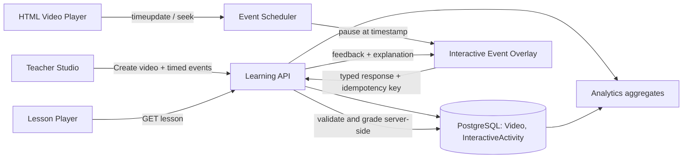
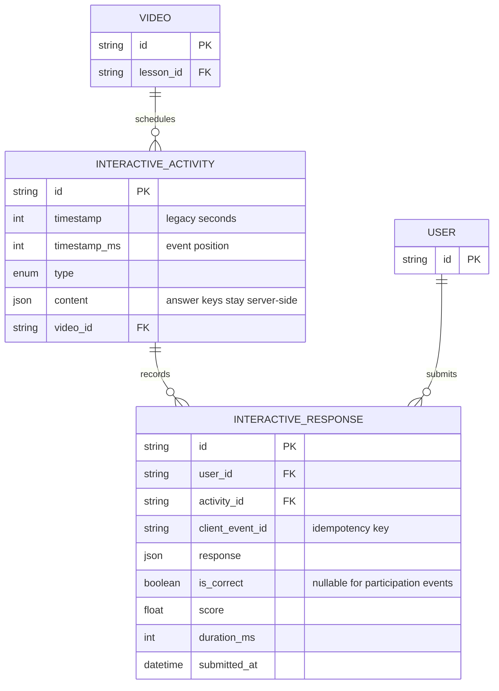
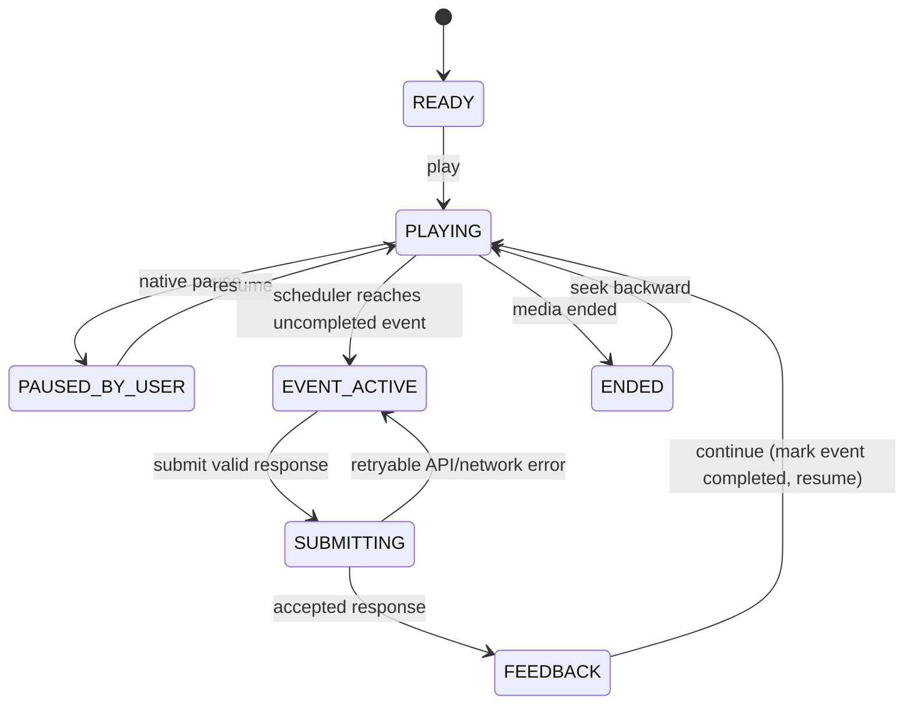

# Smart STEM Interactive Video Engine

## Architecture



PostgreSQL persists immutable event definitions separately from learner response attempts. Event configuration is JSON because each event type has a distinct shape; the API validates it with a discriminated schema on write and read. Correct answers are server-only and are never returned by the lesson endpoint. Responses are append-only, include an idempotency key, and may be aggregated for reporting.



## Event types

| Type | Definition payload | Learner submission | Grading |
|---|---|---|---|
| `QUESTION`, `QUIZ` (legacy) | question/options/correctIndex | selectedIndex | exact option |
| `DRAG_DROP` | prompt, items with target zone IDs, zones | item ID to zone ID mapping | all mappings correct |
| `MATCHING` | left/right items and correct pair mapping | left ID to right ID mapping | all pairs correct |
| `FILL_BLANK` | prompt template, blank IDs, accepted answers | blank ID to text mapping | normalized accepted answer |
| `POLL` | prompt/options, single or multiple selection | selected option IDs | participation; no correct answer |
| `REFLECTION` | prompt, response length bounds | free-text reflection | participation; no correctness score |
| `VOCABULARY` | term, definition, pronunciation, example | viewed | participation |
| `AI_EXPLANATION` | prompt and lesson context | viewed | participation |

Design rules:

- Timestamps are integer milliseconds from the beginning of the media. New clients send `timestampMs`; legacy `timestamp` seconds remain accepted. `timestamp_ms` stores the full millisecond position, while the existing `timestamp` column is maintained as the floored second for compatibility. Event creation rejects negative and duplicate effective timestamps.
- Keep event configuration bounded (at most 20 events/video, at most 20 elements/event, bounded text lengths). Reject unknown event types and invalid references before writing.
- Keep correct-answer configuration in `InteractiveActivity.content` on the server. Student lesson DTOs are constructed from an explicit allow-list and never serialize correct answers or rubrics.
- Poll and reflection events have no answer key. Never call them correct/incorrect; track participation only.
- Store user responses as one attempt row per submission. Derive aggregates from attempts; do not mutate event definitions to store learner state.
- Do not include student PII or response free text in general application logs. Reflection text is restricted educational data and needs an explicit retention/access policy.

## State machine



The scheduler checks all event timestamps crossed by a `timeupdate` or seek, in ascending order, and pauses at the earliest incomplete event. Completed event IDs are tracked per playback session; resetting/replaying the video starts a new session and may allow a deliberate retry policy. The native player stays paused while an event is active, submitting, or showing feedback. A failing submission must not mark the event complete or resume playback.

## API

All routes require app JWT. Teacher event creation and analytics require `TEACHER`/`ADMIN`; learner responses require `STUDENT`. Resolve `userId` from JWT, never from JSON body.

### `POST /api/lessons/:lessonId/videos`

```json
{
  "title": "Fractions in daily life",
  "url": "https://cdn.example.edu/fractions.mp4",
  "activities": [
    {
      "timestampMs": 45000,
      "type": "MATCHING",
      "content": {
        "prompt": "Match each fraction to an equivalent fraction.",
        "leftItems": [{"id": "a", "label": "1/2"}],
        "rightItems": [{"id": "b", "label": "2/4"}],
        "correctPairs": [{"leftId": "a", "rightId": "b"}],
        "explanation": "Multiply numerator and denominator by two."
      }
    }
  ]
}
```

For a compatibility period, legacy `timestamp` in seconds and legacy MCQ content remain accepted. New clients should use `timestampMs`. The API persists milliseconds in `timestamp_ms` and keeps the legacy second field populated for older clients.

### `GET /api/lessons/:id`

Returns event ID, position, type and learner-safe configuration only. It omits `correctIndex`, `correctPairs`, `targetZoneId`, accepted fill answers, and reflection rubrics.

### `POST /api/videos/:videoId/activities/:activityId/responses`

```json
{
  "clientEventId": "e4509b0b-717c-4481-b245-8578a4148df5",
  "durationMs": 18200,
  "response": {
    "type": "MATCHING",
    "pairs": {"a": "b"}
  }
}
```

`response.type` and its structure must match the stored activity type. Server returns `{ accepted, isCorrect, score, explanation, attemptId }`; `isCorrect` is `null` for Poll/Reflection. Repeating a `clientEventId` from the same user returns the original persisted result, not a duplicate attempt.

### `GET /api/videos/:videoId/activities/analytics`

Teacher-scoped aggregate: event count, unique participants, attempts, correctness rate for graded event types, average response duration, and poll option counts. Reflection text is never included in aggregate responses. Authorize the teacher against the video’s owning course before aggregation.

## React component boundaries

- Lesson video player plus `InteractiveVideoStore`: media lifecycle, event scheduler, seeks, completed-event set, resume coordination.
- `InteractiveEventOverlay`: accessible modal/dialog shell, pending/loading/error/feedback states, submit and continue.
- `EventRenderer`: dispatches by event type.
- `DragDropEvent`: pointer/touch and keyboard-operable zone assignment.
- `MatchingEvent`: accessible select controls for each left item.
- `FillBlankEvent`: labelled inputs per blank; normalize only on server.
- `PollEvent`: single/multi-select options.
- `ReflectionEvent`: bounded textarea and explicit data-use notice.
- `QuestionEvent`: legacy MCQ and True/False renderer.

The current lesson page uses the store and shared overlay; the overlay dispatches renderers by event type. Teacher Studio retains the guided MCQ checkpoint form and provides JSON templates for the other event types. The server remains authoritative for validating all authored event content.

## Analytics events

Write `InteractiveResponse` attempt facts: tenant/user/video/activity IDs, client event ID, response JSON, nullable correctness and score, client duration, and server submission time. Derive:

- event reach/completion = distinct learners with a response / eligible learners assigned the lesson;
- correctness = correct graded attempts / graded attempts (exclude Poll/Reflection);
- choice distribution = response counts grouped by stable option ID;
- median/mean time = server-bounded `durationMs` distribution, optionally capped/winsorized;
- retries = attempt count per learner and event.

Keep raw response retention short and purpose-driven, particularly reflection text. Partition the response table only after measuring volume; if partitioned, include the time key in uniqueness/idempotency constraints. For high-volume analytics, publish sanitized events asynchronously to the existing analytics pipeline rather than synchronously computing full-history dashboards from the player request.

## Rollout and non-goals

This implementation extends the existing `InteractiveActivity` JSON payload and adds response persistence without replacing the current lesson/quiz schema. New event authoring can be introduced after teacher UI is wired. It does not provide synchronized multi-user classroom playback, DRM, media transcoding/CDN delivery, or automated assessment of open-ended reflections.
