# Smart STEM AI - PostgreSQL data architecture

## Scope and adoption

This is a production-oriented target design for the modules in the project brief. It is a **reference schema**, not an automatically applied migration. The running application currently uses the smaller Prisma schema in `backend/prisma/schema.prisma` (including `User`, `Class`, `Course`, `Lesson`, `Video`, `InteractiveActivity`, `Quiz`, `Question`, `Answer`, `Progress`, and `QuizAttempt`). Do not run the DDL against an existing database until a staged data migration and application cutover have been prepared.

The target separates global login identities from school membership. A person can therefore use one login in more than one school while roles, profiles, classes, and learning data remain tenant-scoped. Every tenant-owned relationship uses `tenant_id` in its foreign key so accidental cross-school references are rejected by PostgreSQL as well as by application code.

## 1. ER diagram

```mermaid
erDiagram
    TENANTS ||--o| SCHOOLS : configures
    USERS ||--o{ TENANT_MEMBERSHIPS : joins
    TENANTS ||--o{ TENANT_MEMBERSHIPS : owns
    TENANT_MEMBERSHIPS ||--o{ USER_ROLES : granted
    TENANT_ROLES ||--o{ USER_ROLES : assigns
    TENANT_ROLES ||--o{ ROLE_PERMISSIONS : includes
    PERMISSIONS ||--o{ ROLE_PERMISSIONS : defines
    USERS ||--o{ AUTH_IDENTITIES : authenticates
    USERS ||--o{ AUTH_SESSIONS : opens
    TENANT_MEMBERSHIPS ||--o| STUDENT_PROFILES : is
    TENANT_MEMBERSHIPS ||--o| TEACHER_PROFILES : is
    TENANT_MEMBERSHIPS ||--o| PARENT_PROFILES : is
    TENANT_MEMBERSHIPS ||--o{ PARENT_STUDENT_LINKS : parent
    TENANT_MEMBERSHIPS ||--o{ PARENT_STUDENT_LINKS : student
    TENANTS ||--o{ CLASSES : owns
    CLASSES ||--o{ CLASS_MEMBERSHIPS : enrolls
    TENANT_MEMBERSHIPS ||--o{ CLASS_MEMBERSHIPS : learner
    CLASSES ||--o{ CLASS_TEACHERS : taught_by
    TENANT_MEMBERSHIPS ||--o{ CLASS_TEACHERS : teacher
    TENANTS ||--o{ SUBJECTS : owns
    SUBJECTS ||--o{ TOPICS : groups
    SUBJECTS ||--o{ COURSES : classifies
    TOPICS ||--o{ COURSES : classifies
    COURSES ||--o{ LESSONS : contains
    LESSONS ||--o{ VIDEOS : embeds
    VIDEOS ||--o{ INTERACTIVE_EVENTS : pauses_at
    LESSONS ||--o{ QUIZZES : assesses
    QUIZZES ||--o{ QUESTIONS : contains
    QUESTIONS ||--o{ QUESTION_OPTIONS : offers
    TENANTS ||--o{ ASSIGNMENTS : issues
    CLASSES ||--o{ ASSIGNMENTS : receives
    ASSIGNMENTS ||--o{ ASSIGNMENT_SUBMISSIONS : collects
    TENANT_MEMBERSHIPS ||--o{ ASSIGNMENT_SUBMISSIONS : submits
    TENANT_MEMBERSHIPS ||--o{ LESSON_PROGRESS : tracks
    LESSONS ||--o{ LESSON_PROGRESS : records
    QUIZZES ||--o{ QUIZ_ATTEMPTS : attempted
    TENANT_MEMBERSHIPS ||--o{ QUIZ_ATTEMPTS : makes
    QUIZ_ATTEMPTS ||--o{ QUIZ_RESPONSES : answers
    TENANTS ||--o{ VOCABULARY_TERMS : owns
    TOPICS ||--o{ VOCABULARY_TERMS : teaches
    TENANT_MEMBERSHIPS ||--o{ LEARNER_VOCABULARY : studies
    VOCABULARY_TERMS ||--o{ LEARNER_VOCABULARY : learned
    TENANTS ||--o{ BADGES : defines
    TENANT_MEMBERSHIPS ||--o{ ACHIEVEMENTS : earns
    BADGES ||--o{ ACHIEVEMENTS : awards
    TENANT_MEMBERSHIPS ||--o{ AI_CONVERSATIONS : owns
    AI_CONVERSATIONS ||--o{ AI_MESSAGES : contains
    TENANTS ||--o{ LEARNING_EVENTS : records
    TENANTS ||--o{ AUDIT_LOG : audits
    TENANTS ||--o{ REPORT_DEFINITIONS : defines
    REPORT_DEFINITIONS ||--o{ REPORT_RUNS : runs
```

## 2. Entity relationships and tenant boundaries

- `users` stores a global person/login. `tenant_memberships` is the authorization and tenant boundary; do not put school-specific roles directly on `users`.
- `tenants` is the isolation root. `schools` is the school-facing profile for a tenant. A school is one tenant in this design; district/organization tenancy can be added later without changing tenant-scoped foreign keys.
- `tenant_roles` and `permissions` implement RBAC. A user receives roles through a tenant membership. Platform operations should use a separate privileged control plane and must not bypass tenant-scoped authorization in ordinary application requests.
- Student, teacher, and parent are membership profiles. Parent/student relationships are explicit many-to-many links with consent/verification metadata.
- Classes contain student memberships and teacher memberships through effective-dated junction tables. A class may use many courses through `class_courses`.
- Courses are tenant-owned, with bilingual fields and subject/topic references. Lessons contain videos, interactive events, quizzes, and learner progress.
- Quiz attempts and assignment submissions preserve learner answers and grading history. Do not overwrite historical submissions when a learner retries.
- AI conversation messages, analytics events, and audit logs are append-oriented and have separate retention/partitioning needs.
- Foreign keys are tenant-composite for tenant-owned data. Global identity references are the exception: the user itself is global, but its tenant membership is validated by `(tenant_id, membership_id)` references.

## 3. Schema file

The executable PostgreSQL reference DDL is [smart-stem-postgres.sql](./smart-stem-postgres.sql). It creates the extension, enums, tables, check constraints, indexes, partition roots/default partitions, RLS policies, and audit triggers. It is intended for PostgreSQL 15+.

## 4. Indexing strategy

1. Every tenant-owned parent has `UNIQUE (tenant_id, id)` to support composite foreign keys and scoped joins.
2. Tenant-facing list pages use indexes whose leading columns are `(tenant_id, ...)`, often followed by lifecycle/status and sort timestamp.
3. Login lookup uses a case-insensitive unique index on `lower(email)` for active users. OAuth identity is unique per provider and subject.
4. Membership lookup uses `(tenant_id, user_id)` and active class membership indexes. Junction table uniqueness prevents duplicate active enrollment/teaching links.
5. Content navigation uses `(tenant_id, course_id, position)`, `(tenant_id, lesson_id, position)`, and unique slugs within a tenant.
6. Learner history indexes begin with tenant and learner IDs and end with descending event/submission time. Add covering columns only after measuring production query plans.
7. JSONB GIN indexes are intentionally not blanket-created. Add targeted expression/GIN indexes only for demonstrated predicates; avoid indexing high-cardinality or write-heavy event payloads by default.
8. Keep primary/foreign-key indexes explicit where PostgreSQL does not create them automatically (PostgreSQL creates indexes for unique/primary keys but not referencing foreign keys).

## 5. Partitioning and scale to 1M+ users

- Partition `learning_events` and `audit_log` by `RANGE` on UTC timestamp, monthly. The DDL includes a default partition so ingestion is not lost if a future month partition is not created; monitor it and move rows into newly created monthly partitions.
- The composite primary key on partitioned tables includes the partition key because PostgreSQL requires that for partitioned unique constraints. Event IDs are UUIDs; consumers should not assume `id` alone has a global unique constraint enforced by that partitioned table.
- Create next-month partitions ahead of time, alert on default-partition growth, and detach/drop old partitions according to approved retention requirements. Do not partition transactional tables preemptively.
- At one million users, UUID primary keys and tenant-leading indexes are reasonable. Use connection pooling (for example PgBouncer), prepared statements, bounded transactions, statement/lock timeouts, and query-plan monitoring before adding replicas or sharding.
- Keep analytics reads off the OLTP path as volume grows: use asynchronous aggregation/materialized rollups or a warehouse. Avoid synchronous full-history aggregation on learner requests.
- Benchmark using realistic school/tenant skew, concurrent class access, quiz submission bursts, and hot tenants. A global user count alone is not a reason to shard.

## 6. Multi-tenancy and row-level security

- Set `app.tenant_id` transaction-locally from the authenticated membership, e.g. `SET LOCAL app.tenant_id = '...';`. Never take the tenant ID for authorization solely from a user-controlled request parameter.
- The SQL applies an RLS policy to tenant-owned tables. Use a non-owner runtime database role without `BYPASSRLS`; table owners and superusers can bypass normal RLS unless `FORCE ROW LEVEL SECURITY` is enabled.
- Set tenant context and execute the business query in the same transaction/connection. With pooling, session-level settings can leak between requests; `SET LOCAL` avoids that.
- RLS is defense in depth, not a replacement for authorization checks. Test both allowed and denied tenant access in integration tests.
- Background workers must establish tenant context explicitly or use a narrowly privileged, audited worker role.

## 7. Audit trail, retention, and soft delete

- `audit_log` stores actor, action, object key, timestamp, request ID, and before/after JSON snapshots. Audit trigger timestamps use UTC and actor/request IDs come from transaction-local settings.
- Do not put passwords, access tokens, refresh tokens, full AI prompts, or unnecessary child PII into audit snapshots. Restrict audit access and define retention/export policy.
- Mutable business entities use `deleted_at` and `deleted_by_membership_id` for recoverability. Active unique indexes use a predicate (`deleted_at IS NULL`) where appropriate.
- Junction/history records use `ended_at`/`revoked_at` rather than hard deletion when membership or consent history matters.
- Authentication tokens are stored as hashes. Revoke sessions by setting `revoked_at`; never store bearer tokens in plaintext.
- For education/minor data, document guardian consent, purpose limitation, data minimization, access logs, retention/deletion requests, and applicable local privacy-law review before production.

## 8. Production practices

- Apply DDL through reviewed, versioned migrations; never use `db push` as the production migration process.
- Roll out additive changes first: nullable columns/tables/indexes, backfill in batches, dual-read/write if needed, then enforce constraints and remove old columns in a later release.
- For large live tables, use `CREATE INDEX CONCURRENTLY` in a migration step that is not wrapped in a transaction. Add/validate constraints in stages where practical.
- Use `timestamptz` and UTC, `numeric` only where exact decimal arithmetic is required, and `jsonb` only for evolving payloads rather than core relational fields.
- Configure backups and point-in-time recovery; regularly rehearse restore. Monitor replication lag, connection saturation, slow queries, deadlocks, autovacuum, bloat, partition/default-partition growth, and RLS-denied errors.
- Keep schema and application authorization aligned. Validate tenant scoping on every repository method and use composite foreign keys to make cross-tenant links impossible.

## 9. Mapping from current Prisma implementation

| Current application model | Target design |
|---|---|
| `User` with `Role` enum, email/password, Google subject | `users`, `auth_identities`, `tenant_memberships`, `tenant_roles`, `user_roles`, `auth_sessions` |
| `Class` | `classes`, `class_memberships`, `class_teachers`, `class_courses` |
| `Course.subject` string and `level` string | `courses` plus normalized `subjects` and `topics` |
| `Lesson`, `Video`, `InteractiveActivity` | Same concepts with tenant-scoped keys; interactive activity becomes typed `interactive_events` |
| `Quiz`, `Question`, `Answer` | `quizzes`, `questions`, `question_options` |
| `Progress`, `QuizAttempt` | `lesson_progress`, `quiz_attempts`, `quiz_responses` |
| Not currently modeled | Parent/teacher/student profiles, assignments, AI messages, vocabulary, badges/achievements, analytics, reports, audit |

The table/column names in the target are intentionally normalized snake_case and do not directly match Prisma's current quoted PascalCase names. Introduce this target incrementally with explicit Prisma `@@map`/`@map` or a controlled data migration; do not rename tables in place without updating and validating all application queries.
